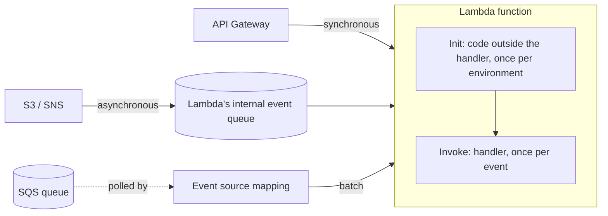

## When to use it / when not to

**Use Lambda when:**

- Work arrives as events: an HTTP request through API Gateway, a message on a queue, an object landing in S3, a schedule.
- Traffic is spiky or unpredictable, and you'd rather pay per request than for idle servers.
- Each unit of work finishes in well under 15 minutes and fits in up to 10 GB of memory.
- You want to glue AWS services together with a small amount of code.

**Look elsewhere when:**

- Work runs longer than 15 minutes, or needs a long-lived process or open connections: use ECS on Fargate, or Step Functions to split the work into steps.
- Traffic is steady and high around the clock. Containers or EC2 are often cheaper at a constant load.
- You need GPUs, or control over the operating system.
- You need consistently low latency and can't tolerate any cold starts, and provisioned concurrency doesn't fit the budget.

**Compare with:** ECS on Fargate for containers without servers, and Step Functions for orchestrating many Lambda calls. A "Lambda vs Fargate vs ECS on EC2" decision guide is coming in Phase 2.

## How it works



**Execution environments.** Lambda runs each function in isolated execution environments. The first request to a new environment runs the *Init* phase: the runtime starts and your code outside the handler runs. That's a cold start. Then the *Invoke* phase runs your handler. Later requests can reuse the warm environment and skip Init. That is why SDK clients belong at module scope, and why module-level state must never hold one user's data for the next.

**Three ways to invoke.** In a *synchronous* call (API Gateway, the SDK's `Invoke` with `RequestResponse`), the caller waits and handles errors itself. In an *asynchronous* call (S3, SNS, `InvocationType=Event`), Lambda queues the event, returns `202`, and retries a function error twice. Add an on-failure destination or a dead-letter queue to keep what still fails. With an *event source mapping* (SQS, Kinesis, DynamoDB Streams), Lambda polls the source and invokes your function with batches. Retries then follow the source's rules; for SQS that means the visibility timeout and the queue's redrive policy.

**Concurrency.** Concurrency is the number of requests in flight at once: *average requests per second × average duration in seconds*. A function averaging 200 ms at 5,000 requests per second needs a concurrency of 1,000, the default Regional quota. *Reserved concurrency* guarantees a function a share of that pool and also caps it there. *Provisioned concurrency* keeps environments initialized ahead of time, which removes cold starts at extra cost.

**Versions and aliases.** Publishing a version freezes the code and configuration. An alias such as `live` points at a version and can split traffic between two versions, for example 90/10, for canary releases. Both versions must be published (an alias can't point at `$LATEST`) and share the same execution role. AWS SAM's `DeploymentPreference` uses this with CodeDeploy for gradual rollouts.

The Lambda docs now call standard functions **Event Functions**, to tell them apart from the newer Lambda Web Functions and Lambda MicroVMs. This page covers Event Functions, which is what the exam and most code mean by "a Lambda function".

## Code

An SQS-triggered worker that records orders in DynamoDB. It shows the patterns from this page: clients at module scope, a partial batch response, and an idempotent conditional write. Credentials come from the function's execution role, so there are no access keys anywhere. CI tests both handlers, and the CDK stack is deployed and checked in a sandbox account.

<CodeTabs
  caption="Python and TypeScript do the same thing; the CDK stack wires the queue, function and table together."
  tabs={[
    { label: 'Python (boto3)', path: 'lambda/python/order_worker/handler.py' },
    { label: 'TypeScript (SDK v3)', path: 'lambda/typescript/order-worker.ts' },
    { label: 'CDK', path: 'lambda/cdk/order-worker-stack.ts' },
  ]}
/>

## Key limits and defaults

<LimitsTable service="lambda" />

## Common mistakes

<MistakesTable service="lambda" />

## Security and cost notes

**Least privilege.** Give each function its own execution role with only the actions it calls, scoped to the resources it touches. The order worker can only put items into one table:

```json
{
  "Version": "2012-10-17",
  "Statement": [
    {
      "Effect": "Allow",
      "Action": "dynamodb:PutItem",
      "Resource": "arn:aws:dynamodb:us-east-1:111122223333:table/Orders"
    }
  ]
}
```

The execution role controls what the function can do. The function's *resource-based policy* controls who can invoke it. Lambda supplies the role's temporary credentials automatically, so never put access keys in environment variables. Keep secrets in Secrets Manager or Parameter Store, and fetch and cache them at Init.

**Networking.** Attach a function to a VPC only when it needs private resources such as an RDS database or ElastiCache. When you do, use private subnets and add VPC endpoints for the AWS services it calls.

**Logs and data.** Log message IDs, not message bodies or prompts, which can contain customer data. CloudWatch Logs data protection can mask sensitive fields that slip through.

**What surprises the bill:**

- *Recursive loops.* A function that writes to its own trigger can run up charges in minutes.
- *Provisioned concurrency.* You pay for it while it is configured, whether or not it is used.
- *Log retention.* A log group created without a retention period keeps logs, and bills for them, forever. Set a retention period, as the CDK sample does.
- *Over-sized memory.* Duration is billed in proportion to memory. Measure with the `Max Memory Used` field in the `REPORT` log line before you size up, or use AWS Lambda Power Tuning.

## Check yourself

<CheckYourself service="lambda" count={5} />

## Go deeper

<GoDeeper service="lambda" />
